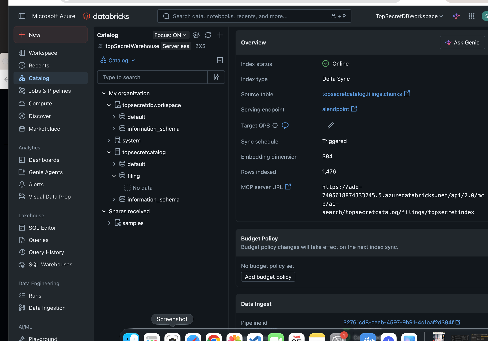
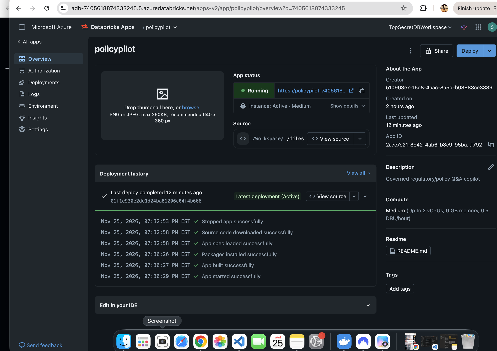
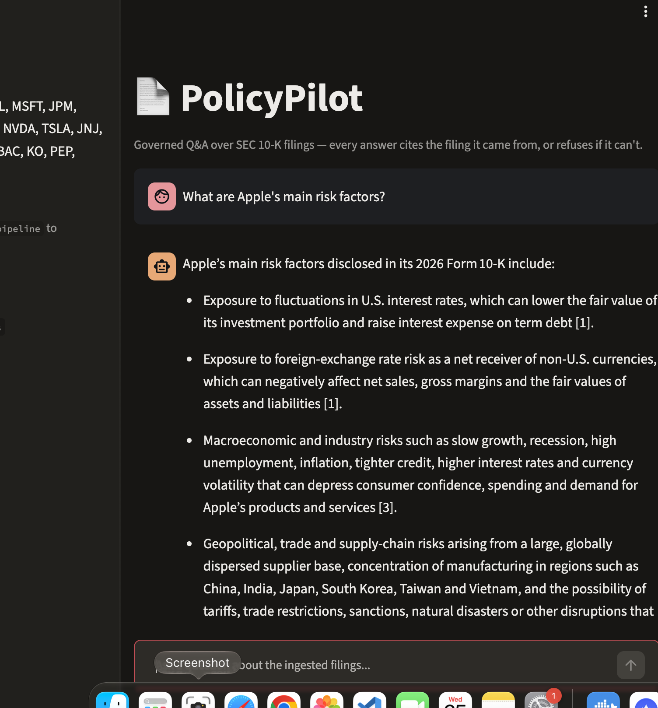
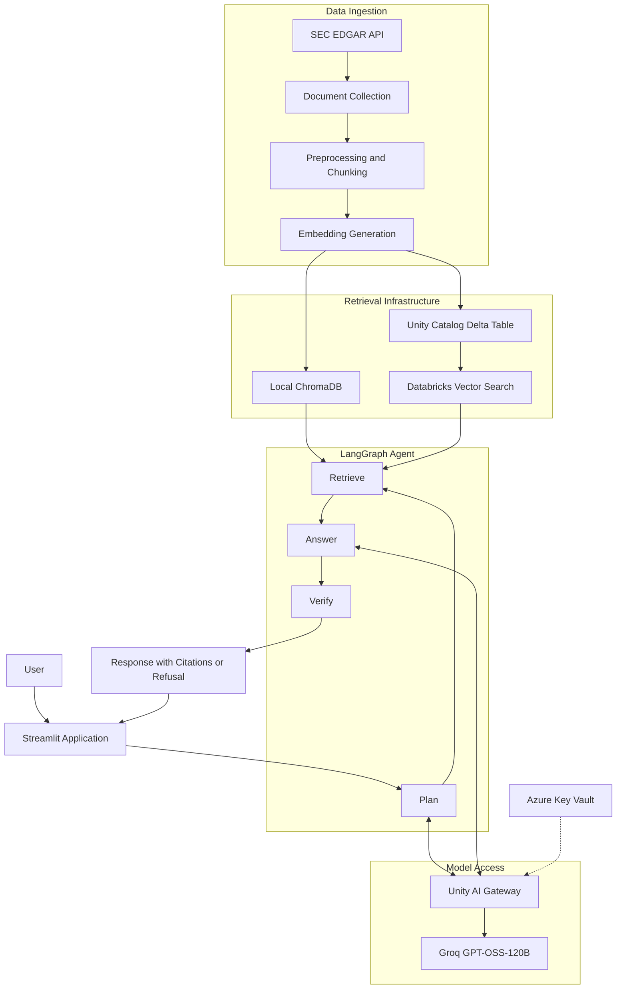
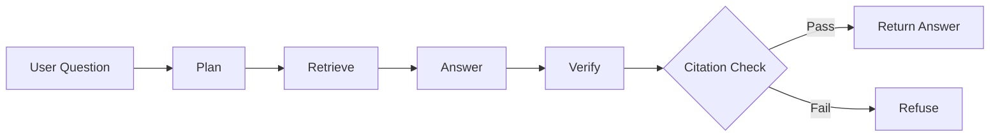
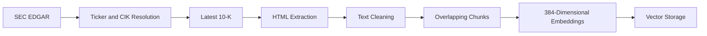
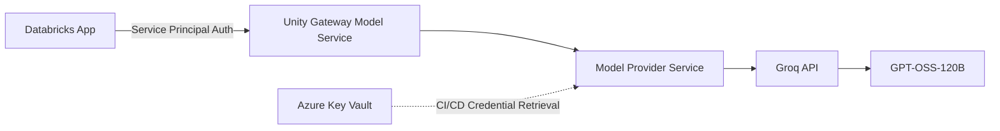
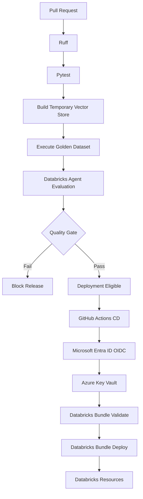

# PolicyPilot — Governed Agentic RAG on Azure Databricks


## Overview

PolicyPilot is an end-to-end regulatory intelligence copilot built using Agentic Retrieval-Augmented Generation (RAG), LangGraph, and Azure Databricks.

I developed this project to explore how enterprise AI applications can combine intelligent document retrieval, agent orchestration, centralized data governance, secure model access, automated evaluation, and reproducible cloud deployment.

PolicyPilot enables users to ask natural-language questions about SEC 10-K filings from major publicly traded companies and receive responses grounded in regulatory disclosures, with traceable source citations.

Unlike a conventional chatbot, PolicyPilot is designed to retrieve relevant evidence before generating an answer and reject responses that fail its citation requirements.

The architecture supports both local development and Azure Databricks deployment without requiring changes to the core agent logic.

## Key Features

- Agentic RAG orchestration using LangGraph.
- Automated SEC EDGAR regulatory filing ingestion.
- Support for approximately 20 publicly traded companies.
- LLM-based company and ticker identification.
- Company-specific semantic retrieval and metadata filtering.
- Source attribution and regulatory document traceability.
- Deterministic citation validation and refusal mechanisms.
- Local and cloud vector search backends.
- Centralized data governance through Unity Catalog.
- Governed LLM access through Unity AI Gateway.
- Secure credential management using Azure Key Vault.
- Dedicated application and deployment service principals.
- Automated evaluation using Databricks Agent Evaluation.
- CI/CD using GitHub Actions and Databricks Asset Bundles.
- Interactive Streamlit application deployed through Databricks Apps.

## Project Status

| Milestone | Scope | Status |
| --- | --- | --- |
| Milestone 1 | Local agentic RAG prototype | Completed |
| Milestone 2 | Azure Databricks deployment and end-to-end validation | Completed |
| Milestone 3 | Expanded dataset, intelligent ticker detection, model governance, and CI evaluation | Code complete — additional validation in progress |
| Milestone 4 | Advanced security testing, observability, and retrieval improvements | Planned |

### Milestone 1 — Local Prototype

The initial implementation established the complete RAG workflow using:

- Real SEC EDGAR filings.
- ChromaDB for local vector storage.
- Sentence Transformers for embedding generation.
- Groq for LLM inference.
- LangGraph for agent orchestration.
- Streamlit for the application interface.

The local environment operates independently of Azure Databricks, although an internet connection and Groq API access are required for ingestion and inference.

### Milestone 2 — Azure Databricks Deployment

The application was deployed and validated within an Azure Databricks environment.

The cloud implementation included:

- Azure Databricks Premium serverless workspace.
- Unity Catalog catalog, schema, and Delta table.
- Azure Key Vault.
- Microsoft Entra ID and GitHub OIDC federation.
- Databricks Vector Search endpoint and index.
- Databricks Apps hosting.
- Dedicated service principal authentication.
- Resource-level authorization.

End-to-end validation successfully returned a grounded, cited answer retrieved from Apple's actual SEC 10-K filing through Databricks Vector Search.

Following validation, billable application compute and Vector Search infrastructure were stopped or removed to minimize ongoing cloud costs.

### Milestone 3 — AI Governance and Evaluation

The current codebase includes:

- Expanded ingestion configuration covering approximately 20 companies.
- Intelligent company and ticker resolution within the LangGraph planner.
- Databricks Agent Evaluation integration.
- An expanded golden dataset of approximately 47 evaluation questions.
- CI evaluation workflow.
- Unity Gateway model provider and model service configuration.
- Governed access to Groq's GPT-OSS-120B model.
- Application-level model execution permissions.

Gateway guardrails require a separate configuration and validation step in the deployed environment.

See [Upgrade Plan](docs/UPGRADE_PLAN.md) for the architectural decisions and implementation roadmap.

## Deployment Evidence

The application was deployed and validated end to end on Azure Databricks on 25 November 2026. The Vector Search endpoint and index were deleted and the app compute was stopped afterwards to avoid ongoing charges. They can be recreated from this repository.

**Vector Search index online, with all 1,476 chunks indexed** (Delta Sync, triggered, 384 dimensions, over `topsecretcatalog.filings.chunks`):



**Databricks App running**, deployed from the Databricks Asset Bundle, with the full deployment history (packages installed, app built, app started):



**Grounded, cited answer** returned by the deployed app for "What are Apple's main risk factors?":



The CI workflow (lint, tests, and an automated evaluation with a citation quality gate) and the CD workflow (Databricks Asset Bundle deployment over OIDC) are visible in the repository's **Actions** tab.

## System Architecture



The system separates document ingestion, storage, retrieval, agent orchestration, inference, governance, and application deployment into independent components.

This separation allows infrastructure components to evolve without requiring a complete rewrite of the agent.

## Agentic RAG Workflow

The core agent is implemented as a LangGraph state machine.



| Node | Responsibility |
| --- | --- |
| `plan_node` | Analyze the user question, identify the target company, resolve its ticker, and generate a retrieval query. |
| `retrieve_node` | Retrieve relevant document chunks using semantic search and company-specific metadata filters. |
| `answer_node` | Generate an answer using retrieved regulatory context and numbered citations. |
| `verify_node` | Apply a deterministic citation check and replace answers that fail the minimum requirement with a refusal. |

### Intelligent Company Resolution

The planner supports both company names and explicit ticker symbols.

For example:

| User Question | Resolved Ticker |
| --- | --- |
| What supply chain risks does Apple disclose? | AAPL |
| What are Microsoft's主要 revenue drivers? | MSFT |
| What risks does NVIDIA identify in its latest filing? | NVDA |
| What cybersecurity risks does JPMorgan disclose? | JPM |

Company detection is integrated into the existing LLM planning operation rather than introducing a separate inference call.

The resolved ticker is used to restrict retrieval to the relevant company's filings, reducing cross-company context contamination.

### Citation Enforcement

The answer generation layer is instructed to use retrieved regulatory context and provide numbered citations.

A deterministic verification step checks whether the generated response contains the required citation format.

Responses that fail this check are replaced with a refusal.

The current mechanism verifies citation presence. Full sentence-level attribution and semantic entailment verification remain planned improvements.

## Data Engineering Pipeline

PolicyPilot retrieves publicly available SEC 10-K filings directly from SEC EDGAR.



### Ingestion Process

1. Resolve company tickers to SEC CIK identifiers.
2. Identify the latest available 10-K filing.
3. Download the regulatory filing.
4. Extract and preprocess document text.
5. Split the document into overlapping chunks.
6. Enrich chunks with filing and company metadata.
7. Generate vector embeddings.
8. Persist document chunks and embeddings.
9. Index the dataset for semantic retrieval.

### Embedding Model

The project uses:

```text
sentence-transformers/all-MiniLM-L6-v2
```

| Parameter | Configuration |
| --- | --- |
| Embedding dimensions | 384 |
| Chunk size | Approximately 1,200 words |
| Chunk overlap | Approximately 200 words |
| Local vector store | ChromaDB |
| Cloud vector store | Databricks Vector Search |
| Cloud index | Delta Sync |
| Embedding management | Self-managed embeddings |
| Retrieval filtering | Company ticker |

Using the same embedding model across both environments maintains compatibility between document ingestion and query embedding generation.

## Local and Cloud Architecture

I designed the retrieval and inference layers around interchangeable interfaces to avoid coupling the core agent to a particular infrastructure backend.

| Component | Local | Azure Databricks |
| --- | --- | --- |
| Agent orchestration | LangGraph | LangGraph |
| Vector storage | ChromaDB | Databricks Vector Search |
| Embeddings | Sentence Transformers | Sentence Transformers |
| Structured storage | Local JSON manifest | Unity Catalog Delta Lake |
| LLM inference | Groq API | Groq through Unity Gateway |
| Model governance | Application-level validation | Unity Gateway and application-level validation |
| Secret management | `.env` | Azure Key Vault |
| Frontend | Streamlit | Databricks Apps |
| Authentication | Local API credentials | Dedicated service principal |
| Ingestion | Python pipeline | Databricks notebook |
| Evaluation | Local citation checks and authenticated evaluation services | Databricks Agent Evaluation |
| Deployment | Local execution | GitHub Actions and Asset Bundles |

The environment is selected through:

```bash
PP_ENV=local
```

or:

```bash
PP_ENV=databricks
```

The agent interacts with two core interfaces:

- `VectorStore`
- `LLMClient`

The corresponding implementations are selected based on the configured environment.

## Azure Databricks Integration

### Unity Catalog

Unity Catalog provides centralized governance for the regulatory document dataset.

The cloud dataset is stored in:

```text
policypilot_dev.filings.chunks
```

The Delta table contains document text, vector embeddings, and source metadata.

```sql id="u7p2c9"
CREATE TABLE IF NOT EXISTS policypilot_dev.filings.chunks (
    chunk_id STRING NOT NULL,
    ticker STRING,
    company STRING,
    filing_date STRING,
    accession_number STRING,
    chunk_index INT,
    text STRING,
    embedding ARRAY<FLOAT>
)
USING DELTA
TBLPROPERTIES (
    delta.enableChangeDataFeed = true
);
```

Change Data Feed supports synchronization between the Delta table and the Vector Search index.

### Databricks Vector Search

The cloud retrieval layer uses a Delta Sync index over the governed document chunks.

The index uses self-managed 384-dimensional embeddings and supports company-specific metadata filtering.

The endpoint and index can be recreated when needed without rebuilding the entire Azure environment.

### Unity AI Gateway

Rather than giving the deployed application direct access to external LLM credentials, I integrated Unity Gateway as the model governance layer.



The application accesses the governed model service:

```text
policypilot_dev.filings.gpt-oss
```

The underlying provider routes requests to:

```text
openai/gpt-oss-120b
```

The architecture separates application authentication from external model provider credentials.

### Databricks Apps

The Streamlit application runs on Databricks-managed compute using its own dedicated service principal.

The runtime service principal is distinct from both the developer identity and the GitHub deployment identity.

This separation allows data access and model execution privileges to be assigned independently.

## Security and AI Governance

Security is implemented across the data, application, model, and deployment layers.

| Security Layer | Implementation |
| --- | --- |
| Cloud identity | Microsoft Entra ID |
| Workload authentication | GitHub OIDC federation |
| Secret management | Azure Key Vault |
| Data authorization | Unity Catalog grants |
| Application identity | Dedicated service principal |
| Model access | Unity Gateway model service |
| Retrieval isolation | Company-specific metadata filtering |
| Response validation | Deterministic citation gate |
| AI safety | Configurable gateway guardrails |
| Deployment security | Separate deployment and runtime identities |

### Guardrail Strategy

The deployed model governance architecture supports the configuration of:

- Prompt injection and jailbreak detection.
- Content safety policies.
- Personally identifiable information detection.
- Off-topic request filtering.
- Personalized investment-advice restrictions.

These controls require configuration and validation within the deployed gateway environment.

Local development bypasses gateway policies and is intended exclusively for trusted development use.

### Data Residency

PolicyPilot currently processes publicly available SEC filings.

Groq remains the inference provider in both environments. Prompts and retrieved context may therefore be processed outside the Azure Databricks boundary.

For confidential or proprietary datasets, a Databricks-hosted model architecture should be evaluated against the applicable data residency and security requirements.

## Testing and Evaluation

The evaluation strategy combines deterministic software tests with AI-specific quality assessment.

### Software Quality

- Ruff static analysis.
- Pytest unit tests.
- Mock LLM responses.
- Agent workflow validation.
- Retrieval component testing.
- Citation and refusal behavior testing.

### LLM Evaluation

PolicyPilot integrates Databricks Agent Evaluation through MLflow's GenAI evaluation capabilities.

```python id="t3x7v6"
mlflow.genai.evaluate(...)
```

The evaluation dataset contains approximately 47 questions covering the ingested companies and an intentionally off-corpus question.

| Evaluation Dimension | Purpose |
| --- | --- |
| Relevance | Evaluate alignment with the user question. |
| Groundedness | Assess whether responses are supported by retrieved context. |
| Safety | Assess potentially unsafe model responses. |
| Citation compliance | Check the required citation format. |
| Refusal behavior | Validate responses to unsupported questions. |
| Retrieval isolation | Assess company-specific context selection. |

Databricks-hosted evaluation judges require authenticated workspace connectivity.

The deterministic citation check can execute independently of the hosted judges.

**Current status (25 November 2026).** In CI, the deterministic citation check runs and returns a score. The Databricks-hosted judges (relevance, groundedness, safety) completed without error but returned no scores, so they are not gated yet; the cause is still being investigated. A quality gate (`src/policypilot/eval/thresholds.py`) fails the CI job when a metric that does return a score falls below its minimum, and only warns when a metric is missing.

## CI/CD Architecture

The delivery architecture uses GitHub Actions and Databricks Asset Bundles.



### Continuous Integration

The CI workflow combines:

- Static code analysis.
- Automated software testing.
- Golden dataset execution.
- LLM response evaluation.
- Deployment quality checks.

The evaluation design uses a temporary local vector store, avoiding the need for a continuously running Databricks Vector Search endpoint.

### Continuous Deployment

The CD workflow handles:

1. GitHub Actions authentication through OIDC.
2. Secure retrieval of the Groq API key from Azure Key Vault.
3. Databricks Asset Bundle validation.
4. Deployment of application and model governance resources.
5. Configuration of resource permissions.

Application compute startup and source deployment are handled as separate lifecycle operations.

## Getting Started

### Prerequisites

- Python 3.11 or later.
- [uv](https://docs.astral.sh/uv/).
- Groq API key.
- Internet access for SEC EDGAR ingestion and LLM inference.
- Azure Databricks workspace access for cloud deployment and hosted evaluation.

### 1. Clone the Repository

```bash
git clone https://github.com/lesliesam96/PolicyPilot.git

cd PolicyPilot
```

### 2. Install Dependencies

```bash
uv sync --extra dev
```

### 3. Configure Environment Variables

```bash
cp .env.example .env
```

Configure the local environment:

```env
PP_ENV=local
GROQ_API_KEY=your_api_key
SEC_EDGAR_USER_AGENT=PolicyPilot your_email@example.com
```

Never commit API credentials or populated `.env` files to version control.

### 4. Ingest SEC Filings

```bash
uv run python -m policypilot.ingestion.pipeline
```

The ingestion pipeline downloads the latest filings for the configured company universe, generates embeddings, and persists them in:

```text
data/chroma/
```

### 5. Start the Application

```bash
uv run streamlit run src/policypilot/app/streamlit_app.py
```

### 6. Run Automated Tests

```bash
uv run pytest
```

Run code quality checks:

```bash
uv run ruff check .
```

### 7. Run Agent Evaluation

```bash
uv sync --extra dev --extra eval

uv run python -m policypilot.eval.agent_eval
```

Databricks authentication is required to execute the hosted evaluation judges.

## Cloud Deployment

The Azure Databricks deployment is managed using:

- `databricks.yml`
- `resources/apps.yml`
- `resources/ai_gateway.yml`
- `.github/workflows/cd.yml`
- `app.yaml`
- `requirements.txt`

The deployment process includes:

1. Configure Azure Databricks and Unity Catalog.
2. Configure Azure Key Vault.
3. Establish GitHub OIDC federation.
4. Configure deployment service principal permissions.
5. Deploy Databricks Asset Bundle resources.
6. Populate the governed Delta table.
7. Provision the Vector Search endpoint and index.
8. Configure application runtime permissions.
9. Start and deploy the Databricks App.
10. Configure and validate gateway guardrails.
11. Execute end-to-end validation.

Detailed deployment instructions are available in:

[Azure Databricks Deployment Guide](docs/DEPLOYMENT_GUIDE.md)

## Repository Structure

```text
PolicyPilot/
│
├── src/
│   └── policypilot/
│       ├── config.py
│       ├── ingestion/
│       │   ├── edgar_client.py
│       │   ├── chunker.py
│       │   ├── pipeline.py
│       │   └── manifest.py
│       │
│       ├── retrieval/
│       │   ├── base.py
│       │   ├── local_chroma.py
│       │   └── databricks_vector_search.py
│       │
│       ├── agent/
│       │   ├── llm.py
│       │   ├── tools.py
│       │   └── graph.py
│       │
│       ├── eval/
│       │   ├── golden_dataset.jsonl
│       │   └── agent_eval.py
│       │
│       └── app/
│           └── streamlit_app.py
│
├── notebooks/
│   └── seed_chunks_table.py
│
├── scripts/
│   └── setup_unity_catalog.py
│
├── resources/
│   ├── apps.yml
│   └── ai_gateway.yml
│
├── tests/
│
├── docs/
│   ├── DEPLOYMENT_GUIDE.md
│   └── UPGRADE_PLAN.md
│
├── .github/
│   └── workflows/
│       ├── ci.yml
│       └── cd.yml
│
├── databricks.yml
├── app.yaml
├── requirements.txt
├── pyproject.toml
├── uv.lock
├── .env.example
├── .gitignore
└── README.md
```

## Technology Stack

| Category | Technologies |
| --- | --- |
| Programming | Python, SQL |
| Agentic AI | LangGraph |
| Generative AI | Groq, GPT-OSS-120B |
| Embeddings | Sentence Transformers |
| Vector Search | ChromaDB, Databricks Vector Search |
| Data Engineering | PySpark, Delta Lake, SEC EDGAR |
| Cloud Infrastructure | Microsoft Azure, Azure Databricks |
| Data Governance | Unity Catalog |
| AI Governance | Unity AI Gateway |
| Application Hosting | Databricks Apps |
| Frontend | Streamlit |
| Identity and Access | Microsoft Entra ID, Service Principals |
| Secret Management | Azure Key Vault |
| Workload Federation | OIDC |
| LLMOps | MLflow, Databricks Agent Evaluation |
| CI/CD | GitHub Actions |
| Deployment Configuration | Databricks Asset Bundles, YAML |
| Testing | pytest, Ruff |
| Dependency Management | uv |

## Engineering Challenges

| Challenge | Engineering Approach |
| --- | --- |
| SEC EDGAR access restrictions | Configure an identifiable User-Agent for document retrieval. |
| Company-name resolution | Integrate LLM-based entity detection into the planning node. |
| Cross-company retrieval contamination | Apply ticker-based metadata filters. |
| Unsupported LLM responses | Introduce deterministic citation validation and refusal behavior. |
| Local and cloud compatibility | Implement interchangeable vector store and LLM client interfaces. |
| Cloud credential management | Use Azure Key Vault and OIDC federation. |
| Runtime authentication | Configure dedicated Databricks application service principals. |
| External model governance | Integrate Unity Gateway model provider and model services. |
| Deployment dependency ordering | Manage gateway resource creation and deployment sequencing. |
| AI response quality | Introduce golden datasets and Databricks Agent Evaluation. |
| Cloud operational costs | Remove unused Vector Search infrastructure and stop application compute. |

## Infrastructure Cost Management

Cloud infrastructure is provisioned according to development and validation requirements.

The project follows a cost-conscious approach:

- Use local development for routine agent testing.
- Use triggered synchronization for Vector Search.
- Configure SQL warehouse auto-stop.
- Provision billable endpoints when required.
- Stop Databricks application compute after validation.
- Delete unused Vector Search indexes and endpoints.
- Retain reusable governance and deployment configurations.

The cloud deployment has been validated, but billable resources are not maintained continuously.

## Current Limitations

- Citation presence does not guarantee sentence-level factual grounding.
- Gateway guardrails require separate deployed-environment validation.
- Local execution does not benefit from gateway-level policies.
- Automated adversarial security testing remains incomplete.
- External Groq inference introduces data residency considerations.
- Multi-company comparative analysis is not fully supported.
- Historical filings and additional regulatory document types are not yet integrated.
- Unity Catalog structured lookup functions remain planned.
- The LangGraph agent is not currently registered and served through Mosaic AI Agent Framework or Databricks Model Serving.

## Roadmap

### AI Security

- [ ] Automated prompt injection regression testing.
- [ ] Deployed gateway security smoke tests.
- [ ] Adversarial evaluation datasets.
- [ ] Sentence-level citation verification.
- [ ] Semantic entailment validation.

### Retrieval and Data Engineering

- [ ] Hybrid semantic and keyword retrieval.
- [ ] Advanced reranking.
- [ ] Automated incremental SEC filing ingestion.
- [ ] Historical filing analysis.
- [ ] Multi-company financial comparison.
- [ ] Support for SEC 10-Q and 8-K filings.
- [ ] Unity Catalog structured lookup functions.

### MLOps and Production Engineering

- [ ] Advanced observability and distributed tracing.
- [ ] Model latency and inference cost monitoring.
- [ ] Automated cloud infrastructure lifecycle management.
- [ ] Model fallback and routing strategies.
- [ ] Deployment-environment regression testing.
- [ ] Databricks-native Foundation Model integration for restricted datasets.

## Documentation

- [Project Overview](docs/PROJECT_DESCRIPTION.md)
- [Azure Databricks Deployment Guide](docs/DEPLOYMENT_GUIDE.md)
- [Architecture Decisions and Upgrade Plan](docs/UPGRADE_PLAN.md)

## Disclaimer

PolicyPilot is an engineering portfolio project designed to demonstrate governed AI, regulatory document retrieval, and cloud application architecture.

It is not intended to provide financial, legal, or personalized investment advice.

Users should independently verify generated information against the original SEC filings.

## Author

**Leslie Tientcheu**

AI Solutions Engineer | Agentic AI | Generative AI | Cloud Engineering | LLMOps

Focused on building secure, scalable, and governed enterprise AI solutions.

[GitHub](https://github.com/lesliesam96)
