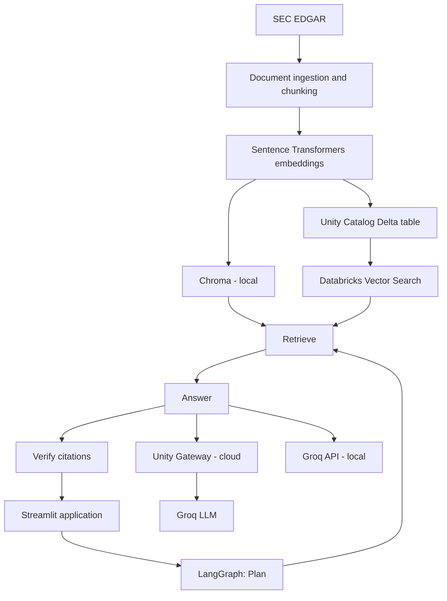
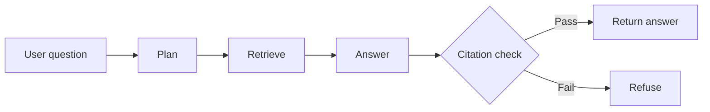

# PolicyPilot — Governed Agentic RAG on Azure Databricks

PolicyPilot is an AI-powered financial document question-answering system designed to retrieve, analyze, and explain information from public SEC 10-K filings. It combines agentic RAG, semantic search, citation-based response validation, and governed LLM access in an Azure Databricks environment.

The goal of this project is to explore how a locally developed AI application can be deployed to a cloud environment with secure authentication, data governance, reproducible deployment, and evaluation capabilities without redesigning the core agent workflow.

## Key features

- Automated ingestion of public SEC EDGAR 10-K filings.
- Semantic document retrieval using local Chroma or Databricks Vector Search.
- Stateful agent orchestration with LangGraph.
- Evidence-grounded answers with numbered source citations and a refusal mechanism.
- Governed LLM access through Databricks Unity Gateway and Groq.
- Centralized data management through Unity Catalog and Delta Lake.
- Secure deployment using GitHub Actions, Microsoft Entra ID OIDC federation, and Azure Key Vault.
- MLflow-based evaluation, automated tests, and a Streamlit interface.

## Architecture



The application separates orchestration from infrastructure through `VectorStore` and `LLMClient` interfaces. The `PP_ENV` environment variable selects the appropriate backend while preserving the same agent logic.

| Component | Local environment | Azure Databricks environment |
|---|---|---|
| Vector storage | Chroma | Unity Catalog Delta table and Vector Search |
| Embeddings | all-MiniLM-L6-v2 | all-MiniLM-L6-v2 |
| LLM access | Groq API | Unity Gateway model service backed by Groq |
| Application | Local Streamlit | Databricks Apps |
| Credentials | Local environment variables | Azure Key Vault and service principals |
| Evaluation | MLflow | Shared evaluation harness |

## Technology stack

| Layer | Technologies |
|---|---|
| Application | Python 3.11+, Streamlit, Pydantic |
| Agentic AI | LangGraph, Groq, GPT-OSS-120B |
| Retrieval | Chroma, Databricks Vector Search, Sentence Transformers |
| Data engineering | SEC EDGAR, BeautifulSoup, PySpark, Delta Lake |
| Cloud and governance | Azure Databricks, Unity Catalog, Unity Gateway, Azure Key Vault |
| Identity and deployment | Microsoft Entra ID, OIDC, GitHub Actions, Databricks Asset Bundles |
| Evaluation and testing | MLflow, pandas, pytest, Ruff |
| Dependency management | uv |

## Data ingestion and retrieval

The ingestion pipeline resolves company tickers to SEC Central Index Keys (CIKs), identifies recent 10-K filings, downloads their HTML content, and extracts the text using BeautifulSoup.

Documents are split into approximately 1,200-word chunks with a 200-word overlap. Each chunk is embedded using `all-MiniLM-L6-v2`, which produces 384-dimensional vectors. The same embedding model is used across environments to maintain retrieval compatibility.

The cloud ingestion notebook writes the following schema to `policypilot_dev.filings.chunks`:

```sql
CREATE TABLE IF NOT EXISTS policypilot_dev.filings.chunks (
    chunk_id STRING NOT NULL,
    ticker STRING,
    company STRING,
    filing_date STRING,
    accession_number STRING,
    chunk_index INT,
    text STRING,
    embedding ARRAY<FLOAT>
)
USING DELTA
TBLPROPERTIES (delta.enableChangeDataFeed = true);
```

The Vector Search index uses `chunk_id` as its primary key, the existing 384-dimensional embedding column, and triggered synchronization. This avoids unnecessary continuous compute for the demonstration workload.

## Agent workflow



1. **Plan:** Transform the question into a retrieval query and identify relevant company tickers using a known ticker list.
2. **Retrieve:** Search the vector index and optionally perform structured lookup.
3. **Answer:** Generate an answer using retrieved filing content, with bracketed citations such as `[1]` and `[2]`.
4. **Verify:** Apply a deterministic citation-presence check and refuse responses that fail it.

The citation gate is a lightweight safeguard, not a full factual entailment verifier. The project uses prompting and retrieval grounding alongside this check to reduce unsupported responses.

## Security and governance

The cloud architecture separates the deployment identity from the application runtime identity. GitHub Actions authenticates to Azure through OIDC federation rather than a stored Azure client secret. The deployment workflow retrieves the Groq API key from Azure Key Vault, masks it in workflow logs, and passes it to the Databricks bundle at deployment time.

The Streamlit application calls the Unity Gateway model service using its own Databricks service principal. It does not need direct access to the Groq API key.

| Identity | Access |
|---|---|
| GitHub deployment service principal | Azure resource permissions, workspace access, required Unity Catalog privileges, gateway service creation, Key Vault secret retrieval |
| Databricks App service principal | Read access to the chunks table and index, endpoint `CAN_USE`, model service `EXECUTE` |
| Administrator | Gateway management and execution privileges |

The model service supports optional safety, PII, off-topic, and investment-advice guardrails. PolicyPilot is intended for filing analysis, not personalized investment recommendations.

## Repository structure

```text
.
├── .github/workflows/cd.yml
├── databricks.yml
├── resources/
│   ├── apps.yml
│   └── ai_gateway.yml
├── app.yaml
├── requirements.txt
├── pyproject.toml
├── uv.lock
├── .env.example
├── src/policypilot/
│   ├── config.py
│   ├── ingestion/
│   │   ├── edgar_client.py
│   │   ├── chunker.py
│   │   ├── pipeline.py
│   │   └── manifest.py
│   ├── retrieval/
│   │   ├── base.py
│   │   ├── local_chroma.py
│   │   └── databricks_vector_search.py
│   ├── agent/
│   │   ├── llm.py
│   │   ├── tools.py
│   │   └── graph.py
│   ├── eval/
│   │   ├── golden_dataset.jsonl
│   │   └── agent_eval.py
│   └── app/streamlit_app.py
├── notebooks/seed_chunks_table.py
├── scripts/setup_unity_catalog.py
└── tests/
```

## Getting started locally

### Prerequisites

- Python 3.11+
- [uv](https://docs.astral.sh/uv/)
- A [Groq API key](https://console.groq.com)

Install dependencies and configure the environment:

```bash
uv sync --extra dev
cp .env.example .env
```

Set the following values in `.env`:

```dotenv
PP_ENV=local
GROQ_API_KEY=<your-groq-api-key>
SEC_EDGAR_USER_AGENT="PolicyPilot research your-email@example.com"
```

Use a real contact email for SEC EDGAR requests. Verify the available Groq model IDs before selecting a model. Do not commit the `.env` file.

Run ingestion, launch the application, and execute the evaluation harness:

```bash
uv run python -m policypilot.ingestion.pipeline
uv run streamlit run src/policypilot/app/streamlit_app.py --server.port 8600
# Run in a separate terminal
uv run python -m policypilot.eval.agent_eval
```

The local interface is available at `http://localhost:8600`.

## Azure Databricks deployment

The deployment uses a Premium serverless Azure Databricks workspace with Unity Catalog, Azure Key Vault, and GitHub Actions.

### 1. Provision infrastructure

Create an Azure resource group, a budget with alerts, a Databricks workspace, and a Key Vault. Store the Groq key as `groq-api-key`. Create the `policypilot_dev` catalog, `filings` schema, and Delta chunks table shown above.

An optional Key Vault-backed Databricks secret scope can be configured for notebook use; the deployment workflow reads Key Vault directly.

### 2. Configure identity federation

Register a Microsoft Entra ID application and configure a GitHub federated credential matching the `dev` GitHub environment. Grant the deployment principal the required Azure resource and Key Vault permissions, and separately register it in Databricks.

```sql
GRANT USE CATALOG ON CATALOG policypilot_dev TO `<deployment-client-id>`;
GRANT USE SCHEMA ON SCHEMA policypilot_dev.filings TO `<deployment-client-id>`;
GRANT SELECT, MODIFY ON TABLE policypilot_dev.filings.chunks TO `<deployment-client-id>`;
GRANT CREATE SERVICE ON SCHEMA policypilot_dev.filings TO `<deployment-client-id>`;
```

Configure these GitHub environment secrets:

| Secret | Purpose |
|---|---|
| `AZURE_CLIENT_ID` | Entra application ID |
| `AZURE_TENANT_ID` | Azure tenant ID |
| `AZURE_SUBSCRIPTION_ID` | Azure subscription |
| `DATABRICKS_HOST` | Workspace URL |
| `KEY_VAULT_NAME` | Vault containing the Groq key |

### 3. Deploy the Databricks Asset Bundle

Update `databricks.yml` with the workspace host, catalog, and administrator username. The bundle defines the Databricks App and Unity Gateway provider/model services. The development target is configured independently of staging and production placeholders.

The gateway provider uses the full Groq chat completions endpoint:

```text
https://api.groq.com/openai/v1/chat/completions
```

The model service routes to `openai/gpt-oss-120b`. The application calls it through the Databricks unified API:

```text
POST https://<workspace-url>/ai-gateway/mlflow/v1/chat/completions
model: policypilot_dev.filings.gpt-oss
```

Trigger the CD workflow in GitHub Actions with target `dev`. The workflow authenticates through OIDC, retrieves the key from Key Vault, and runs:

```bash
databricks bundle validate -t dev
databricks bundle deploy -t dev
```

Verify the model service in Databricks Playground before deploying the application runtime.

### 4. Seed data and create the index

Run `notebooks/seed_chunks_table.py` in Databricks. Verify the ingested data:

```sql
SELECT ticker, COUNT(*)
FROM policypilot_dev.filings.chunks
GROUP BY ticker;
```

Create a Standard Vector Search endpoint named `policypilot-vs-endpoint` and the `policypilot_dev.filings.chunks_index` index. Select existing embeddings, dimension 384, and triggered updates. Wait until the index is ready and its indexed row count matches the source table. The seeding notebook appends records, so avoid rerunning it against an already populated table unless intentionally reseeding.

### 5. Configure runtime access and start the application

Grant the application's own service principal access independently from the deployment principal:

```sql
GRANT USE CATALOG ON CATALOG policypilot_dev TO `<app-client-id>`;
GRANT USE SCHEMA ON SCHEMA policypilot_dev.filings TO `<app-client-id>`;
GRANT SELECT ON TABLE policypilot_dev.filings.chunks TO `<app-client-id>`;
GRANT SELECT ON TABLE policypilot_dev.filings.chunks_index TO `<app-client-id>`;
```

Grant endpoint `CAN_USE` and model service `EXECUTE`. Start the application compute and deploy the source directory uploaded by the bundle. The application configuration is located at the repository root:

```yaml
command: ["streamlit", "run", "src/policypilot/app/streamlit_app.py"]
env:
  - name: PP_ENV
    value: databricks
```

Open the Databricks App URL using an authenticated workspace session.

## Testing and evaluation

```bash
uv run ruff check .
uv run pytest
uv run python -m policypilot.eval.agent_eval
```

The evaluation harness uses a golden dataset and MLflow to record results. The validation strategy includes relevant filing questions, citation formatting, off-corpus refusal, and end-to-end retrieval and generation. When gateway guardrails are enabled, personalized investment-advice requests should also be tested for blocking.

| Scenario | Expected behavior |
|---|---|
| Question about an ingested company's disclosed risks | Grounded answer with filing citations |
| Question outside the document corpus | Refusal when evidence is insufficient |
| Answer without numbered citations | Rejected by the citation gate |
| Personalized stock purchase recommendation | Blocked when the investment-advice policy is enabled |
| Cloud retrieval and generation | Successful use of Vector Search and Unity Gateway under runtime credentials |

## Engineering challenges and design decisions

The transition from local development to Databricks introduces several infrastructure and integration considerations documented in the original build guide.

| Challenge | Resolution |
|---|---|
| SEC EDGAR rejects generic User-Agent headers | Configure a real contact email |
| Groq model IDs contain slashes that legacy serving endpoint configuration rejects | Use Unity Gateway provider and model services |
| Gateway creation-order race on initial bundle deployment | Rerun deployment once the provider exists |
| Azure RBAC does not grant internal Databricks access | Configure workspace identities and Unity Catalog grants separately |
| App runtime cannot use notebook-based credential discovery | Pass injected service principal credentials explicitly to VectorSearchClient |
| Databricks host can be injected without a URL scheme | Normalize the host to HTTPS |
| Deployment succeeds but gateway services are not visible | Apply explicit administrator grants in the bundle |
| Streamlit imports fail when only the app subdirectory is deployed | Deploy the repository root |
| Vector Search initial index provisioning race | Inspect pipeline events and recreate the affected index if the documented race occurs |
| MLflow table logging rejects a list of dictionaries | Convert evaluation records to a pandas DataFrame |

## Cost management

Vector Search endpoints and Databricks App compute are the main resources to monitor during demonstrations. Configure Azure budget alerts before provisioning, use triggered index synchronization, and stop application compute when not needed.

For a temporary demonstration, delete the Vector Search index before deleting its endpoint. Preserve the Delta table, workspace configuration, identity federation, and gateway configuration if needed for future deployments. Revoke temporary personal access tokens used during troubleshooting. Actual cloud charges depend on resource usage and pricing.

## Limitations and next steps

- The corpus is limited to ingested public SEC 10-K filings.
- The citation gate checks citation presence rather than verifying every claim against its source.
- The current ingestion notebook requires care to avoid duplicate rows when rerun.
- Separate staging and production environments remain future deployment targets.
- Potential improvements include idempotent ingestion, claim-level citation validation, expanded evaluation metrics, and automated index provisioning.

## Author

**Leslie Tientcheu** — AI Solutions Developer | Applied AI & Agentic Systems

[GitHub](https://github.com/lesliesam96)
