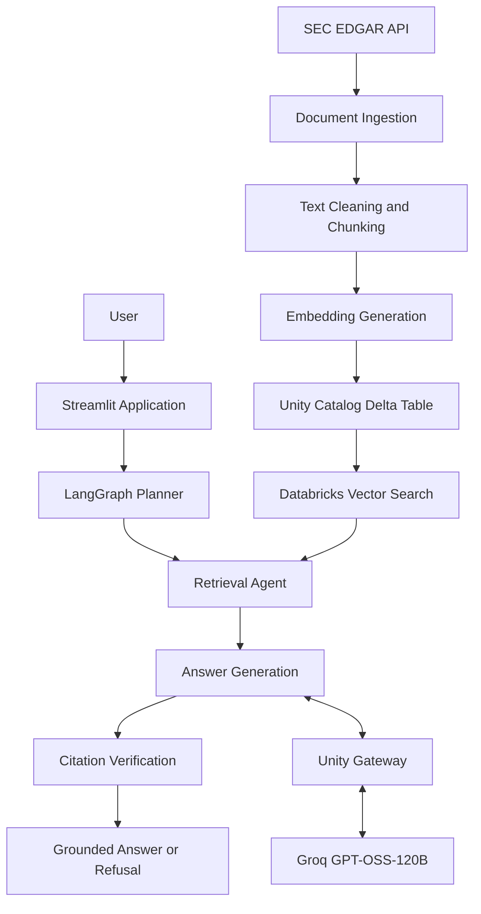

# PolicyPilot — Governed Agentic RAG on Azure Databricks

## Project Overview

PolicyPilot is an end-to-end AI-powered regulatory intelligence assistant designed to help users explore, analyze, and retrieve reliable information from SEC 10-K filings through natural language queries.

My objective with this project was to build a governed agentic RAG architecture that combines reliable information retrieval, LLM orchestration, enterprise data governance, cloud security, and automated deployment.

The application is designed to answer questions about the financial disclosures, business operations, and risk factors of 20 major publicly traded companies, including Apple, Microsoft, NVIDIA, and JPMorgan.

Rather than relying on the LLM's internal knowledge, PolicyPilot generates responses grounded in retrieved regulatory documents, provides numbered source citations, and refuses to answer when sufficient supporting evidence is unavailable.

## Key Features

- Automated ingestion of SEC 10-K filings from SEC EDGAR.
- Agentic Retrieval-Augmented Generation using LangGraph.
- Company-specific semantic search and metadata filtering.
- Source attribution with company names, filing dates, and accession numbers.
- Citation enforcement and refusal mechanisms.
- Enterprise data governance through Unity Catalog.
- Secure LLM integration through Unity Gateway.
- Dual local and cloud execution environments.
- Automated deployment through GitHub Actions.
- LLM evaluation, unit testing, and optional AI safety guardrails.
- Interactive Streamlit application.

## System Architecture

The architecture separates data ingestion, retrieval, agent orchestration, model access, governance, and application deployment.

## Agentic Workflow

I structured the LangGraph workflow around four dedicated nodes to maintain clear responsibilities and predictable execution.

| Node | Responsibility |
| --- | --- |
| Plan | Analyze the user question, identify the target company, and generate an optimized retrieval query. |
| Retrieve | Perform semantic search against the relevant company's regulatory filings. |
| Answer | Generate a contextual response using retrieved document chunks and numbered citations. |
| Verify | Apply a deterministic citation check and reject responses that do not satisfy the minimum citation requirement. |

The company-specific retrieval strategy reduces cross-company information contamination, particularly when regulatory documents contain similar financial terminology and standardized disclosures.

The verification layer complements prompt-based instructions with programmatic validation.

## Data Ingestion and Retrieval

The ingestion pipeline retrieves publicly available regulatory filings directly from SEC EDGAR.

The pipeline handles:

- Company ticker and CIK resolution.
- Latest 10-K filing identification.
- HTML extraction and text preprocessing.
- Document chunking with overlapping windows.
- Metadata enrichment.
- Embedding generation.
- Vector storage and indexing.

For semantic retrieval, I selected the `all-MiniLM-L6-v2` sentence-transformers model, which generates 384-dimensional embeddings.

Using the same embedding model across local and cloud environments ensures consistency between development and deployment.

## Azure Databricks Integration

### Unity Catalog

Regulatory document chunks, embeddings, and associated metadata are stored in a governed Delta table.

Unity Catalog provides centralized access control and separates permissions between deployment identities and application runtime identities.

Change Data Feed is enabled to support synchronization with the vector search index.

### Databricks Vector Search

The cloud retrieval backend uses a Delta Sync index with self-managed embeddings.

The retrieval layer supports:

- Semantic similarity search.
- Company-level metadata filtering.
- Source document traceability.
- Triggered index synchronization.

### Unity Gateway

Rather than exposing the external LLM provider directly to the deployed application, I designed the model access layer around Unity Gateway.

The gateway connects to Groq's `openai/gpt-oss-120b` model through a model provider service and a governed model service.

This architecture supports centralized model access management, usage tracking, configurable guardrails, and separation between application credentials and external provider secrets.

### Databricks Apps

The Streamlit application is deployed through Databricks Apps and operates using a dedicated service principal with restricted permissions.

The runtime identity is separated from the deployment identity, following the principle of least privilege.

## Security and Governance

Security was an important consideration throughout the architecture.

| Security component | Implementation |
| --- | --- |
| Cloud authentication | Microsoft Entra ID and OIDC federation |
| Secret management | Azure Key Vault |
| Data governance | Unity Catalog |
| Model access | Unity Gateway |
| Runtime isolation | Dedicated application service principal |
| Authorization | Resource-level permissions and Unity Catalog grants |
| Answer validation | Deterministic citation enforcement |
| AI safety | Configurable safety, PII, off-topic, and investment-advice guardrails |

The application does not require direct access to the Groq API key in the Databricks environment.

## CI/CD and Deployment

The delivery architecture uses GitHub Actions and Databricks Asset Bundles to support reproducible cloud deployments.

The deployment workflow includes:

1. GitHub Actions authentication through OIDC federation.
2. Secure retrieval of the LLM API key from Azure Key Vault.
3. Databricks Asset Bundle validation.
4. Deployment of application and gateway resources.
5. Configuration of resource permissions.
6. Application deployment and end-to-end validation.

The CI pipeline includes Ruff for code quality checks and pytest for automated testing.

The use of workload identity federation eliminates the need for long-lived Azure authentication secrets in GitHub.

## Testing and Evaluation

The evaluation strategy combines traditional software testing with LLM-specific quality assessment.

- Unit testing with pytest.
- Mock LLM responses for deterministic testing.
- Code quality validation with Ruff.
- Golden question datasets.
- MLflow and Databricks Agent Evaluation.
- Groundedness, relevance, and safety assessment.
- Off-topic query testing.
- Citation validation and refusal testing.
- End-to-end application smoke tests.

The objective is to evaluate not only whether the application executes correctly, but also whether its responses are relevant, grounded, and appropriately restricted.

## Local and Cloud Environments

I designed the retrieval and LLM layers around interchangeable interfaces to avoid coupling the agent logic to a specific infrastructure provider.

| Component | Local Environment | Cloud Environment |
| --- | --- | --- |
| Vector store | ChromaDB | Databricks Vector Search |
| Data storage | Local persistence | Unity Catalog and Delta Lake |
| LLM access | Groq API | Unity Gateway |
| Application | Streamlit | Databricks Apps |
| Embeddings | Sentence Transformers | Sentence Transformers |
| Orchestration | LangGraph | LangGraph |
| Secret management | Environment variables | Azure Key Vault and managed credentials |

The execution environment is controlled through the `PP_ENV` environment variable, allowing the same agent architecture to operate across both environments.

## Technology Stack

| Category | Technologies |
| --- | --- |
| Programming | Python, SQL |
| Agent orchestration | LangGraph |
| Generative AI | Groq, GPT-OSS-120B |
| Embeddings | Sentence Transformers |
| Vector databases | ChromaDB, Databricks Vector Search |
| Data engineering | PySpark, Delta Lake, SEC EDGAR API |
| Cloud platform | Microsoft Azure, Azure Databricks |
| Data governance | Unity Catalog |
| AI governance | Unity Gateway |
| Security | Azure Key Vault, Microsoft Entra ID, OIDC |
| Frontend | Streamlit |
| MLOps and evaluation | MLflow, Databricks Agent Evaluation |
| CI/CD | GitHub Actions, Databricks Asset Bundles |
| Testing | pytest, Ruff |
| Dependency management | uv |

## Engineering Challenges

The project addresses several practical engineering challenges associated with deploying enterprise AI applications:

- Maintaining retrieval consistency between local and cloud environments.
- Preventing cross-company information contamination.
- Managing external LLM access through a governed gateway.
- Separating cloud deployment permissions from runtime permissions.
- Resolving service principal authentication issues.
- Managing infrastructure dependencies during deployment.
- Enforcing minimum citation requirements beyond prompt engineering.
- Controlling cloud infrastructure costs.

## Future Improvements

- Sentence-level citation and entailment verification.
- Hybrid search and advanced reranking.
- Automated incremental ingestion of new SEC filings.
- Multi-company comparative financial analysis.
- Expanded regression and adversarial evaluation datasets.
- Enhanced observability and operational monitoring.
- Automated infrastructure provisioning and lifecycle management.

## Documentation

- [Deployment Guide](DEPLOYMENT_GUIDE.md)
- [Repository Setup](../README.md)

## Author

**Leslie Tientcheu**

AI Solutions Engineer | Agentic AI | Generative AI | Cloud Engineering

[GitHub — lesliesam96](https://github.com/lesliesam96)
