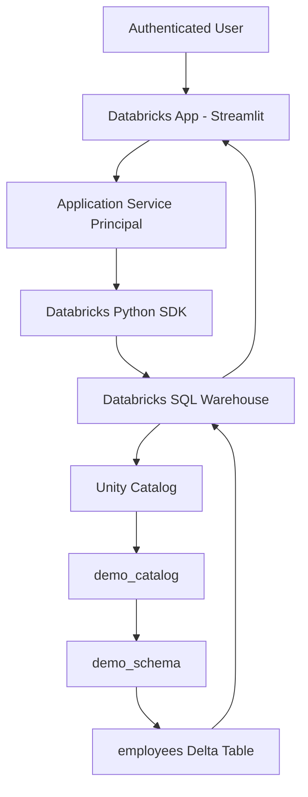
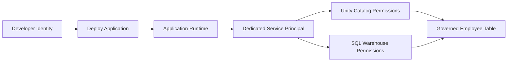

# Unity Catalog & Databricks Apps — Data Governance and Application Integration

## Overview

This standalone implementation explores the integration of Unity Catalog and Databricks Apps within an Azure Databricks environment.

My objective was to understand and demonstrate how enterprise data governance, application deployment, service principal authentication, and resource-level access control work together within the Databricks ecosystem.

I implemented a lightweight Employee Directory application that retrieves governed data directly from a Unity Catalog table through a Databricks SQL warehouse.

This implementation is independent of PolicyPilot but follows the same security and governance principles used in its architecture.

## Architecture



## Technical Objectives

- Implement centralized data governance using Unity Catalog.
- Create and manage catalogs, schemas, and tables.
- Configure granular access control using SQL grants.
- Deploy an interactive Streamlit application on Databricks-managed compute.
- Integrate the Databricks Python SDK with a SQL warehouse.
- Implement application authentication through a dedicated service principal.
- Enforce the principle of least privilege.
- Validate application-to-data connectivity.
- Manage cloud resource lifecycle and infrastructure costs.

## Technology Stack

| Component | Technology |
| --- | --- |
| Cloud platform | Microsoft Azure |
| Data platform | Azure Databricks |
| Data governance | Unity Catalog |
| Data storage | Delta Lake |
| Query engine | Databricks SQL Warehouse |
| Application hosting | Databricks Apps |
| Frontend | Streamlit |
| Backend integration | Databricks Python SDK |
| Authentication | Databricks SSO and Service Principals |
| Authorization | Unity Catalog Grants |
| Programming languages | Python, SQL |

## 1. Unity Catalog — Data Governance

Unity Catalog provides a centralized governance layer for data and AI assets within Databricks.

It enables organizations to manage data access, permissions, auditing, and lineage across workspaces.

Assets are organized through a three-level namespace:

```text
catalog.schema.object
```

For this implementation, I used the following structure:

```text
demo_catalog
└── demo_schema
    └── employees
```

This hierarchy separates data organization from application logic and allows permissions to be managed at different resource levels.

### 1.1 Catalog and Schema Configuration

I configured a dedicated catalog and schema using Databricks-managed storage.

```sql
CREATE CATALOG IF NOT EXISTS demo_catalog;

CREATE SCHEMA IF NOT EXISTS demo_catalog.demo_schema;
```

The isolated catalog provides an independent environment for testing governance and application integration without modifying existing project resources.

### 1.2 Table Creation

The employee dataset contains four attributes:

| Column | Data Type | Description |
| --- | --- | --- |
| id | INT | Employee identifier |
| name | STRING | Employee name |
| department | STRING | Business department |
| salary | DOUBLE | Employee salary |

```sql
CREATE TABLE IF NOT EXISTS demo_catalog.demo_schema.employees (
    id INT,
    name STRING,
    department STRING,
    salary DOUBLE
)
USING DELTA;
```

### 1.3 Sample Data Ingestion

```sql
INSERT INTO demo_catalog.demo_schema.employees VALUES
    (1, 'Alice', 'Engineering', 95000),
    (2, 'Bob', 'Sales', 72000),
    (3, 'Carol', 'Marketing', 68000),
    (4, 'Dave', 'Engineering', 88000);
```

Data availability can be verified through the SQL Editor:

```sql
SELECT *
FROM demo_catalog.demo_schema.employees;
```

### 1.4 Access Control

Unity Catalog allows permissions to be assigned directly to governed resources.

For example, granting read-only access to an authorized user:

```sql
GRANT USE CATALOG
ON CATALOG demo_catalog
TO `someone@example.com`;

GRANT USE SCHEMA
ON SCHEMA demo_catalog.demo_schema
TO `someone@example.com`;

GRANT SELECT
ON TABLE demo_catalog.demo_schema.employees
TO `someone@example.com`;
```

This approach enables granular authorization without providing unnecessary administrative or modification privileges.

## 2. Databricks Apps — Application Layer

Databricks Apps enables interactive applications to run directly within the Databricks environment using managed compute.

For this implementation, I selected Streamlit to provide a lightweight Python-based user interface connected to governed data.

The application uses the Databricks Python SDK to execute SQL queries against a Databricks SQL warehouse.

### Application Features

- Live retrieval of employee records from Unity Catalog.
- Interactive department filtering.
- Tabular data visualization.
- Secure authentication through Databricks-managed identities.
- Cached query results to reduce unnecessary warehouse requests.
- No hardcoded authentication credentials.

### 2.1 Project Structure

```text
employee-directory-demo/
├── app.py
├── app.yaml
├── requirements.txt
└── README.md
```

### 2.2 Dependencies

`requirements.txt`

```text
streamlit
databricks-sdk
```

### 2.3 Application Configuration

`app.yaml`

```yaml
command:
  - streamlit
  - run
  - app.py
```

### 2.4 Application Implementation

`app.py`

```python
import streamlit as st
from databricks.sdk import WorkspaceClient

st.set_page_config(
    page_title="Employee Directory",
    page_icon="🗂️",
    layout="wide"
)

st.title("Employee Directory")

st.caption(
    "Employee data retrieved from a governed "
    "Unity Catalog Delta table."
)

WAREHOUSE_ID = "<YOUR_SQL_WAREHOUSE_ID>"

workspace = WorkspaceClient()


@st.cache_data(ttl=30)
def load_employees():
    result = workspace.statement_execution.execute_statement(
        statement="""
            SELECT id, name, department, salary
            FROM demo_catalog.demo_schema.employees
        """,
        warehouse_id=WAREHOUSE_ID,
    )

    columns = [
        column.name
        for column in result.manifest.schema.columns
    ]

    rows = result.result.data_array or []

    return columns, rows


columns, rows = load_employees()

departments = ["All"] + sorted({
    row[2] for row in rows
})

selected_department = st.selectbox(
    "Filter by department",
    departments
)

filtered_rows = [
    row for row in rows
    if selected_department == "All"
    or row[2] == selected_department
]

st.metric("Employees", len(filtered_rows))

st.dataframe(
    [
        dict(zip(columns, row))
        for row in filtered_rows
    ],
    use_container_width=True
)
```

## 3. Application Authentication and Authorization

One of the most important architectural considerations in this implementation is the separation between developer identity and application runtime identity.

Every Databricks App receives a dedicated service principal.

The application does not automatically inherit the permissions of the developer who created or deployed it.



This identity separation provides a foundation for secure application deployment and least-privilege access control.

### 3.1 Unity Catalog Permissions

The application's service principal requires explicit permissions to access the catalog, schema, and table.

```sql
GRANT USE CATALOG
ON CATALOG demo_catalog
TO `<APP_SERVICE_PRINCIPAL_CLIENT_ID>`;

GRANT USE SCHEMA
ON SCHEMA demo_catalog.demo_schema
TO `<APP_SERVICE_PRINCIPAL_CLIENT_ID>`;

GRANT SELECT
ON TABLE demo_catalog.demo_schema.employees
TO `<APP_SERVICE_PRINCIPAL_CLIENT_ID>`;
```

The application only requires read access. No `MODIFY`, `CREATE TABLE`, or administrative privileges are necessary for this use case.

### 3.2 SQL Warehouse Permissions

In addition to Unity Catalog privileges, the application's service principal requires `CAN_USE` permission on the SQL warehouse.

These permissions are managed independently.

| Resource | Required Permission |
| --- | --- |
| Catalog | USE CATALOG |
| Schema | USE SCHEMA |
| Employees table | SELECT |
| SQL warehouse | CAN_USE |

This configuration ensures that the application has access only to the resources required for its operation.

## 4. Application Deployment

The deployment process consists of the following steps:

1. Configure the Unity Catalog resources.
2. Create and populate the Delta table.
3. Configure a Databricks SQL warehouse.
4. Create a Databricks App.
5. Configure the Streamlit application and dependencies.
6. Retrieve the application's service principal identifier.
7. Assign Unity Catalog and SQL warehouse permissions.
8. Start the application compute.
9. Deploy the application source code.
10. Validate application connectivity and functionality.

Application registration, compute startup, and source code deployment are separate lifecycle operations.

## 5. Validation Strategy

The validation process covers both application functionality and security configuration.

| Test Case | Expected Behavior |
| --- | --- |
| SQL query execution | Employee records are returned successfully. |
| Application startup | Streamlit interface loads correctly. |
| Department filtering | Only matching employees are displayed. |
| Missing table permissions | Data access is denied. |
| Missing warehouse permissions | SQL execution is denied. |
| Read-only permissions | Application can retrieve data without modification privileges. |
| Cached queries | Repeated requests can reuse cached results within the configured TTL. |
| Authentication | Authorized users can access the application through Databricks. |

## 6. Engineering Challenges and Considerations

### Identity Isolation

The application operates under a separate service principal rather than the developer's personal identity.

This requires explicit runtime permissions, even when the developer already has access to the underlying data.

### Multi-Layer Authorization

Successful query execution requires both Unity Catalog data permissions and SQL warehouse permissions.

Granting access at only one layer is insufficient.

### Credential Management

The Databricks SDK uses the application's configured authentication environment, avoiding the need to embed personal access tokens or authentication secrets directly in the source code.

### Query Performance

Streamlit caching reduces repeated queries to the SQL warehouse.

For larger datasets, additional improvements could include server-side filtering, pagination, and query optimization.

### Resource Lifecycle Management

Databricks application compute and SQL warehouse usage can generate cloud infrastructure costs.

Application compute should be stopped when it is not required, and SQL warehouse auto-stop should be configured appropriately.

## 7. Security and Governance

The implementation follows several enterprise security principles:

- Centralized data governance.
- Dedicated application runtime identities.
- Least-privilege authorization.
- Resource-level access control.
- Separation of developer and application permissions.
- Credential-free application source code.
- Governed access to structured data.
- Infrastructure lifecycle management.

These principles also serve as the foundation for more complex data and AI applications.

## 8. Relationship to PolicyPilot

This standalone implementation explores the same governance mechanisms used in my PolicyPilot agentic RAG architecture at a smaller scale.

| Component | Employee Directory | PolicyPilot |
| --- | --- | --- |
| Data governance | Unity Catalog | Unity Catalog |
| Data storage | Employee Delta table | SEC filing chunks and embeddings |
| Retrieval | Databricks SQL | Databricks Vector Search |
| Application | Streamlit | Streamlit |
| Hosting | Databricks Apps | Databricks Apps |
| Authentication | Application service principal | Application service principal |
| Authorization | SQL and UC permissions | UC, Vector Search, and model service permissions |
| AI orchestration | Not required | LangGraph |
| Model governance | Not required | Unity Gateway |

The simplified architecture isolates the core governance and application integration mechanisms without introducing the complexity of an LLM, vector embeddings, or agent orchestration.

## 9. Resource Cleanup

To remove the resources created specifically for this implementation:

```sql
DROP TABLE IF EXISTS demo_catalog.demo_schema.employees;

DROP SCHEMA IF EXISTS demo_catalog.demo_schema;

DROP CATALOG IF EXISTS demo_catalog;
```

Stop and delete the Databricks App when it is no longer needed.

Verify that unused SQL warehouses and application compute are stopped to avoid unnecessary infrastructure charges.

## 10. Future Improvements

- Row-level security.
- Column-level masking for sensitive employee data.
- User-specific authorization.
- Server-side query filtering.
- Parameterized SQL queries.
- Asynchronous SQL execution and error handling.
- Automated infrastructure deployment using Databricks Asset Bundles.
- GitHub Actions CI/CD integration.
- Automated integration and authorization testing.
- Application monitoring and observability.

## Author

**Leslie Tientcheu**

AI Solutions Engineer | Agentic AI | Cloud Engineering | Data Governance

[GitHub — lesliesam96](https://github.com/lesliesam96)
