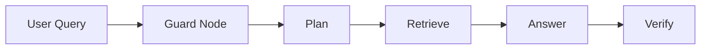
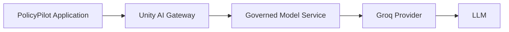
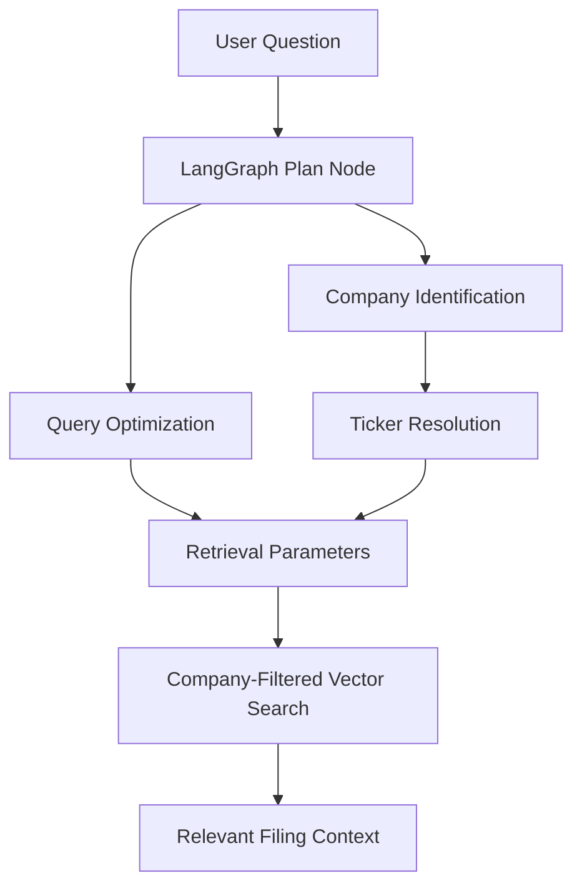
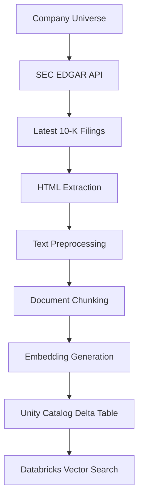
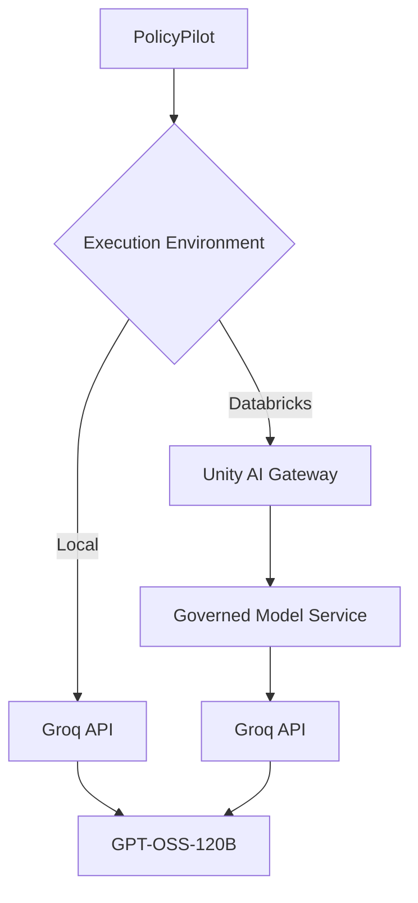
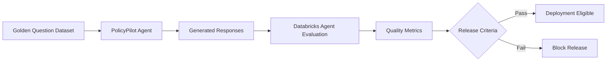
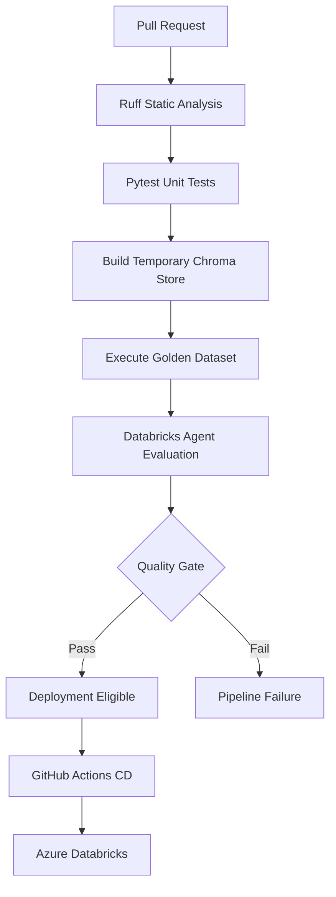
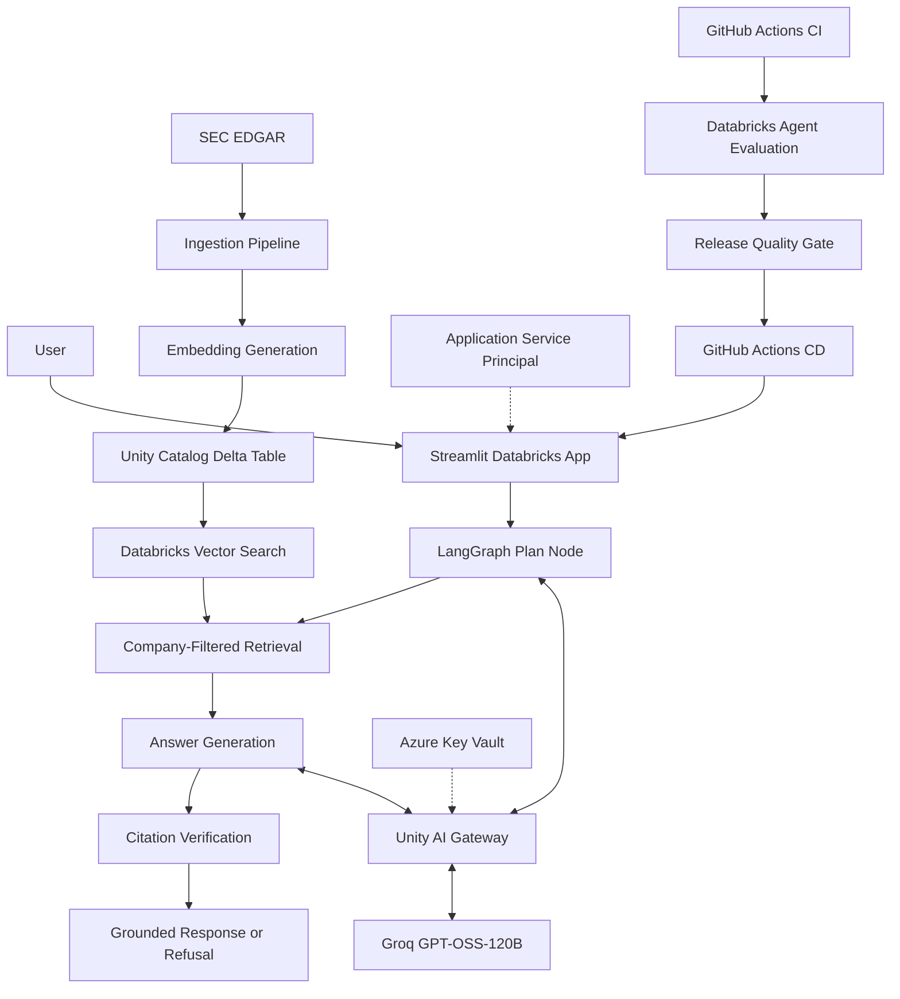

# PolicyPilot — Engineering Roadmap & Architecture Decisions

## 1. Overview

As part of the continuous development of PolicyPilot, I identified four major areas of improvement to strengthen the application's reliability, scalability, security, and production readiness.

The objective of this engineering roadmap is to evolve PolicyPilot into a governed agentic RAG application while maintaining a modular architecture, minimizing infrastructure costs, and ensuring consistency between local development and cloud deployment.

The proposed improvements focus on:

- AI security and centralized guardrails.
- Intelligent company and ticker identification.
- Regulatory document ingestion scalability.
- LLM provider integration and governance.
- Automated LLM evaluation and deployment quality gates.

During the architectural review, I identified an opportunity to consolidate two initially independent workstreams into a single model governance solution.

## 2. Architecture Decision Summary

| ID | Engineering Objective | Selected Architecture | Decision |
| --- | --- | --- | --- |
| ADR-001 | AI safety and guardrails | Unity AI Gateway | Approved |
| ADR-002 | Intelligent ticker detection | LLM-based entity resolution within LangGraph | Approved |
| ADR-003 | Dataset scalability | Expand SEC 10-K ingestion to 15–20 companies | Approved |
| ADR-004 | LLM infrastructure | Retain Groq behind Unity AI Gateway | Approved |
| ADR-005 | Automated AI evaluation | Databricks Agent Evaluation integrated into CI | Approved |
| ADR-006 | Databricks Foundation Model migration | Revisit when data residency requirements justify migration | Deferred |

## 3. ADR-001 — Centralized AI Security and Guardrails

### Problem Statement

PolicyPilot requires additional security controls to reduce risks associated with untrusted user inputs, prompt injection, inappropriate content, sensitive information, and requests outside the application's intended regulatory domain.

### Initial Approach

My initial approach was to introduce a dedicated security node into the LangGraph workflow.



The security node would perform an additional LLM classification call before allowing a request to enter the retrieval pipeline.

Although this approach provides application-level flexibility, it introduces additional inference latency and requires maintaining security policies directly within the application code.

### Selected Architecture

I selected Unity AI Gateway as the centralized governance layer for the deployed LLM integration.



The gateway provides a centralized location for model access policies and configurable security controls.

### Planned Security Controls

| Security Control | Purpose |
| --- | --- |
| Prompt injection detection | Identify attempts to override application instructions |
| Jailbreak detection | Identify attempts to bypass model restrictions |
| PII detection | Identify potentially sensitive personal information |
| Content safety | Restrict inappropriate or unsafe content |
| Off-topic detection | Restrict requests outside the regulatory filing domain |
| Investment-advice detection | Prevent personalized trading and investment recommendations |
| Citation verification | Reject answers that fail the application-level citation requirement |

The citation verification mechanism remains within the LangGraph workflow. Gateway-level policies complement rather than replace application-level validation.

### Design Rationale

Centralizing model security policies provides several architectural benefits:

- Reduces duplication of security logic.
- Simplifies policy management.
- Avoids introducing an additional classification node into the agent.
- Separates AI governance from business logic.
- Supports centralized model access management.
- Preserves the existing LLM provider integration.

### Alternative Considered: Shieldstral

I also considered Shieldstral, Mistral's specialized safety classification model.

While it represents a suitable option for custom policy enforcement, self-hosting an additional safety model would introduce infrastructure and operational overhead.

This approach remains a potential future enhancement for environments requiring dedicated application-level safety classification.

## 4. ADR-002 — Intelligent Company and Ticker Resolution

### Problem Statement

The initial ticker detection implementation relies on exact symbol matching against a predefined list.

```python
DEFAULT_TICKERS = ["AAPL", "MSFT", "JPM"]
```

This approach correctly identifies explicit ticker symbols but does not reliably resolve natural-language company names.

For example:

| User Query | Initial Detection |
| --- | --- |
| What risks does AAPL disclose? | AAPL |
| What risks does Apple disclose? | Not resolved |
| What are Microsoft's revenue drivers? | Not resolved |
| What cybersecurity risks does JPMorgan disclose? | Not resolved |

This limitation becomes increasingly important as the document corpus expands.

### Selected Approach

I decided to integrate company identification into the existing LangGraph `plan_node`.

The planner already uses an LLM to transform natural-language questions into optimized retrieval queries.

Extending the existing structured output allows the planner to perform both query generation and company identification without introducing a separate LLM call.

### Target Planning Output

```json
{
  "company": "Apple Inc.",
  "ticker": "AAPL",
  "search_query": "Supply chain risks disclosed in the latest 10-K filing"
}
```

### Target Workflow



### Expected Benefits

- Natural-language company identification.
- Support for ticker symbols and company names.
- Improved retrieval precision.
- Reduced cross-company information contamination.
- Improved scalability as new companies are ingested.
- No additional dedicated LLM classification request.

Ticker resolution should be validated against the available company metadata before retrieval to prevent unsupported or hallucinated ticker assignments.

## 5. ADR-003 — Regulatory Dataset Scalability

### Objective

Expand the SEC filing corpus beyond the initial three-company dataset and target a minimum ingestion volume of 25 MB.

### Scaling Strategies Considered

| Strategy | Benefits | Trade-offs |
| --- | --- | --- |
| Add more companies | Broader industry coverage and improved entity-resolution testing | Larger ingestion and indexing workload |
| Add historical filings | Supports historical financial analysis | Requires fiscal-year resolution |
| Add filing types | Expands regulatory information coverage | Requires additional document-type metadata |
| Combine all strategies | Maximum coverage | Increased architectural complexity |

### Selected Strategy

I selected horizontal expansion across approximately 15–20 publicly traded companies, using the latest available SEC 10-K filing for each company.

This strategy directly supports the intelligent ticker-resolution improvement while keeping the existing metadata structure relatively stable.

### Representative Company Coverage

| Company | Ticker | Industry |
| --- | --- | --- |
| Apple | AAPL | Technology |
| Microsoft | MSFT | Technology |
| NVIDIA | NVDA | Semiconductors |
| JPMorgan Chase | JPM | Financial Services |

The final company list can be extended according to corpus coverage, ingestion size, and evaluation requirements.

### Data Ingestion Architecture



### Evaluation Dataset Expansion

The golden evaluation dataset should grow proportionally with the regulatory corpus.

Additional evaluation scenarios should include:

- Company-name resolution.
- Ticker-symbol resolution.
- Financial disclosure questions.
- Risk factor analysis.
- Business operations questions.
- Cross-company retrieval isolation.
- Unsupported questions.
- Off-topic questions.
- Citation and refusal behavior.

The initial evaluation dataset contains 13 questions covering three companies. Expanding this dataset is part of the planned scalability work.

## 6. ADR-004 — LLM Provider and Governance Strategy

### Architectural Question

Should PolicyPilot migrate from Groq to Databricks Foundation Models, or retain its external LLM provider while adopting Databricks-native governance?

### Options Evaluated

| Evaluation Criteria | Groq + Unity AI Gateway | Databricks Foundation Models |
| --- | --- | --- |
| Provider flexibility | High | More platform-dependent |
| Local and cloud model consistency | Supported | Requires backend adaptation |
| Centralized governance | Supported through gateway | Native integration |
| Data residency | External provider processing | Potentially improved platform isolation |
| Existing application compatibility | High | Requires migration |
| Migration effort | Lower | Higher |

### Selected Architecture

I decided to retain Groq as the inference provider across both execution environments.

Databricks remains responsible for the governed data, retrieval, model access, application hosting, and evaluation layers.



### Decision Rationale

The current document corpus consists of publicly available SEC regulatory filings.

A full migration to Databricks-hosted Foundation Models would introduce additional engineering work without addressing an immediate confidentiality requirement for the existing corpus.

Retaining Groq preserves the current inference integration and allows the project to adopt centralized governance independently of its model provider.

### Data Residency Considerations

The gateway does not eliminate external model processing.

Prompts and retrieved regulatory context may still be transmitted to Groq for inference.

Therefore, the current architecture should not be interpreted as guaranteeing that all data remains within the Azure Databricks environment.

A future migration to Databricks-hosted models should be evaluated if PolicyPilot begins processing confidential, proprietary, or otherwise restricted documents.

## 7. ADR-005 — Automated LLM Evaluation and Release Quality Gates

### Problem Statement

Traditional software tests are necessary but insufficient for evaluating an agentic RAG application.

An application can execute successfully while generating irrelevant, unsupported, or unsafe responses.

The evaluation architecture must therefore assess both software correctness and AI response quality.

### Initial Evaluation Architecture

The initial project includes a custom MLflow-based evaluation harness and a golden question dataset.

Maintaining separate local and cloud evaluation mechanisms was considered but introduces a potential inconsistency: different judges may produce different quality scores for the same response.

### Selected Approach

I selected Databricks Agent Evaluation as the primary LLM evaluation framework, integrated into GitHub Actions.

The custom evaluation harness is planned for retirement in favor of a consistent evaluation process using Databricks-hosted judges.

MLflow remains part of the underlying evaluation and experiment-tracking ecosystem.

### Evaluation Dimensions

| Metric | Purpose |
| --- | --- |
| Groundedness | Evaluate whether responses are supported by retrieved context |
| Relevance | Evaluate alignment with the user's question |
| Safety | Identify potentially unsafe responses |
| Guideline adherence | Evaluate compliance with application-specific instructions |
| Citation compliance | Validate the required citation format |
| Refusal behavior | Evaluate responses to unsupported questions |
| Retrieval isolation | Evaluate whether the correct company's documents are retrieved |

### Evaluation Pipeline



The evaluation thresholds should be established using baseline results and adjusted according to the application's quality requirements.

### CI Integration

The proposed continuous integration workflow combines deterministic software testing with AI-specific evaluation.



This architecture avoids maintaining a continuously running Databricks Vector Search endpoint solely for evaluation purposes.

### Authentication and Secret Management

The planned CI workflow requires:

- Access to Groq for executing the golden question dataset.
- Microsoft Entra ID authentication.
- GitHub Actions OIDC federation.
- Connectivity to Databricks evaluation services.
- Secure management of required provider credentials.

OIDC federation avoids the need for long-lived Azure authentication secrets in GitHub.

## 8. Target System Architecture



The target architecture separates the application into dedicated engineering layers:

| Layer | Responsibility |
| --- | --- |
| Data ingestion | Regulatory document collection and preprocessing |
| Data governance | Unity Catalog permissions and metadata management |
| Retrieval | Company-filtered vector search |
| Agent orchestration | LangGraph state management and execution |
| Model inference | Groq |
| AI governance | Unity AI Gateway |
| Application | Streamlit and Databricks Apps |
| Cloud security | Azure Key Vault, Entra ID, and service principals |
| Quality assurance | pytest, Ruff, and Databricks Agent Evaluation |
| Delivery | GitHub Actions and Databricks Asset Bundles |

## 9. Implementation Roadmap

### Phase 1 — Intelligent Retrieval and Dataset Expansion

**Objective:** Improve retrieval reliability and increase regulatory document coverage.

Planned deliverables:

- LLM-based company identification.
- Structured planner output.
- Ticker validation.
- Expanded company universe.
- SEC filing ingestion.
- Dataset size verification.
- Expanded golden evaluation dataset.

Acceptance criteria:

- Company names and ticker symbols resolve correctly.
- Retrieval remains restricted to the intended company's documents.
- Unsupported companies are handled appropriately.
- Corpus ingestion reaches the defined size target.

### Phase 2 — Automated Evaluation and CI Integration

**Objective:** Establish a consistent quality gate before introducing additional infrastructure changes.

Planned deliverables:

- Databricks Agent Evaluation integration.
- GitHub Actions evaluation workflow.
- OIDC authentication configuration.
- Temporary Chroma evaluation environment.
- Evaluation metrics and release thresholds.
- Deployment eligibility enforcement.

Acceptance criteria:

- Evaluation executes automatically within CI.
- Results are captured consistently.
- Failed quality checks prevent deployment eligibility.
- The evaluation workflow does not require a persistent Vector Search endpoint.

### Phase 3 — Centralized Model Governance

**Objective:** Introduce a governed cloud inference path without migrating the underlying LLM provider.

Planned deliverables:

- Unity AI Gateway integration.
- Governed model provider and model service configuration.
- Secure provider credential management.
- Application service principal permissions.
- Configurable security policies.
- Updated Databricks LLM client.
- Gateway smoke testing.

Acceptance criteria:

- The deployed application accesses Groq through the governed gateway.
- The deployed application does not directly hold the Groq API key.
- Authorized application identities can execute model requests.
- Configured security policies are validated against representative test cases.

## 10. Risk Register and Known Limitations

| Risk | Impact | Mitigation |
| --- | --- | --- |
| Incorrect ticker resolution | Retrieval from an unintended company | Validate resolved entities against corpus metadata |
| Cross-company retrieval contamination | Incorrect financial information | Apply company-specific retrieval filters |
| Incomplete citation verification | Unsupported claims may pass a basic citation check | Introduce sentence-level verification and entailment checks |
| Missing gateway test coverage | Security policy regressions may go undetected | Add deployed-environment security smoke tests |
| External LLM processing | Data residency concerns | Reassess provider architecture for confidential datasets |
| Evaluation differences between environments | Inconsistent release decisions | Use a centralized evaluation framework |
| Cloud infrastructure costs | Unnecessary operational expenses | Use ephemeral evaluation resources and stop unused compute |
| Local environment without gateway policies | Unfiltered model interactions | Restrict local mode to trusted development environments |

## 11. Current Gaps

The following limitations are explicitly identified within the proposed architecture:

- Gateway guardrails are not exercised by the local CI evaluation pipeline.
- Automated deployed-environment security tests remain to be implemented.
- The existing CI workflow requires additional authentication and provider access configuration.
- Local execution does not benefit from the deployed gateway's security policies.
- Citation presence alone does not guarantee factual entailment or complete grounding.
- Full data residency is not guaranteed when using an external inference provider.
- The 25 MB corpus target requires verification after ingestion.
- Evaluation thresholds require baseline measurement before enforcement.

These limitations are documented to distinguish architectural objectives from verified implementation results.

## 12. Future Engineering Improvements

Following the implementation of the core roadmap, additional improvements may include:

- Automated adversarial and prompt-injection testing.
- Sentence-level citation verification.
- Semantic entailment validation.
- Hybrid retrieval and advanced reranking.
- Historical SEC filing analysis.
- Multi-company financial comparison.
- Support for additional regulatory document types.
- Automated incremental ingestion.
- Model fallback and routing strategies.
- Production observability and alerting.
- Model latency and inference cost monitoring.
- Automated gateway policy deployment.
- Databricks-hosted Foundation Models for restricted datasets.

## 13. Engineering Principles

The architectural decisions are guided by the following principles:

- Security by design.
- Defense in depth.
- Least-privilege access.
- Modular and interchangeable components.
- Provider-independent AI governance.
- Reproducible cloud deployments.
- Evaluation-driven development.
- Infrastructure cost awareness.
- Explicit documentation of architectural trade-offs.

## Author

**Leslie Tientcheu**

AI Solutions Engineer | Agentic AI | Cloud Architecture | MLOps | AI Governance

[GitHub — lesliesam96](https://github.com/lesliesam96)
